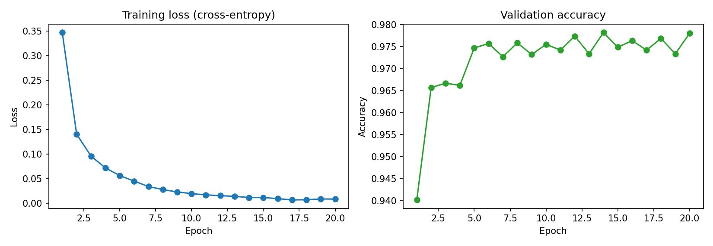
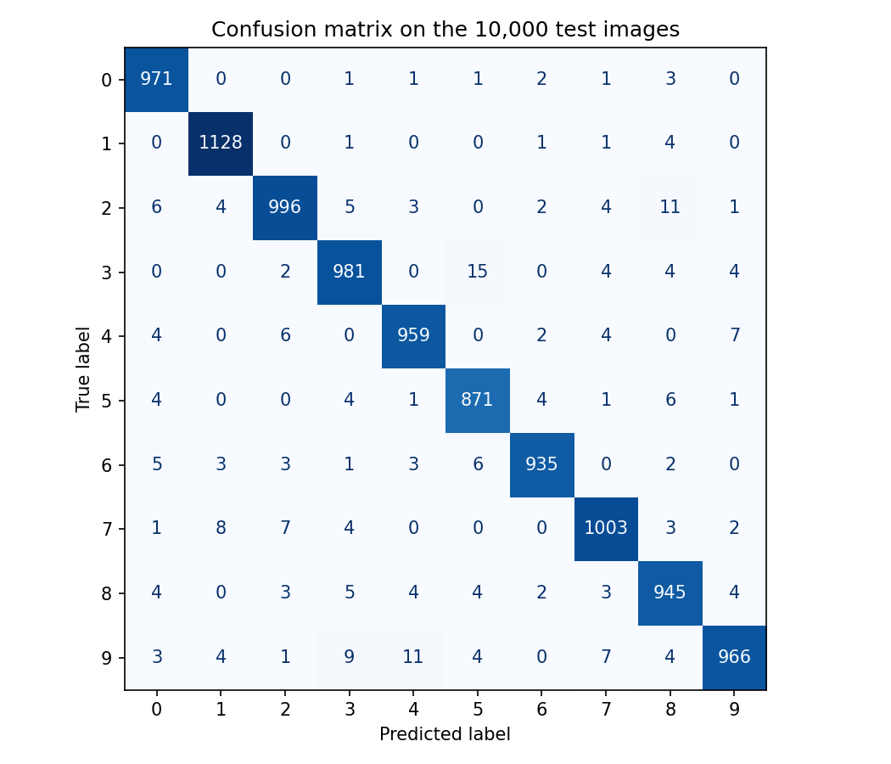

# Handwritten Digit Recognition (MNIST)

A neural network that recognises handwritten digits 0 to 9 from 28 × 28 pixel images, built with scikit-learn's `MLPClassifier`.

## Results

| Measure | Value |
|---|---|
| Test accuracy | **97.55%** (9,755 of 10,000 digits) |
| Test loss (cross-entropy) | 0.0974 |
| Training accuracy | 99.60% |
| Best validation accuracy | 97.82% |
| Epochs | 20 (early stopping) |
| Parameters | 109,386 |

The most common mistakes were 3 read as 5 (15 times), 9 read as 4 (11) and 2 read as 8 (11).




## How it works

1. **Data:** MNIST from OpenML (`mnist_784`), 70,000 images. The standard split is used, with the first 60,000 images for training and the last 10,000 for testing.
2. **Preprocessing:** pixel values are divided by 255 so they lie between 0 and 1. Each image is kept as a flat vector of 784 values, which is the input an MLP expects.
3. **Network:** 784 inputs, then 128 ReLU neurons, then 64 ReLU neurons, then 10 softmax outputs. It is trained with the Adam optimiser at a learning rate of 0.001 in batches of 128. 10% of the training images are held back for validation, and training stops when the validation score has not improved for 5 epochs.
4. **Evaluation:** test accuracy, log loss, a classification report, a confusion matrix and examples of misclassified digits.

## Run it

```bash
python -m venv .venv
source .venv/bin/activate        # Windows: .venv\Scripts\activate
pip install -r requirements.txt
```

Open `mnist.ipynb` in VS Code or Jupyter, pick the `.venv` kernel and run all cells. The first run downloads MNIST (about 15 MB). Training takes a few seconds on a laptop. Results can differ very slightly between library versions.

## Files

- `mnist.ipynb`: the notebook, with outputs.
- `figures/`: sample digits, training curves, the confusion matrix and misclassified examples.
- `results.json`: the scores from the last run.
