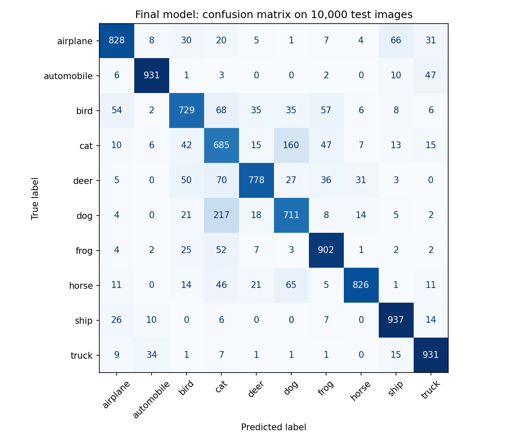
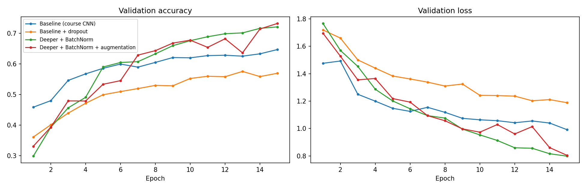

# CIFAR-10 Image Classification with a CNN (Apple MLX)

A convolutional neural network for the 10-class CIFAR-10 dataset, built with [Apple MLX](https://github.com/ml-explore/mlx) and trained on the GPU of an Apple M5 Mac.

## Results on the 10,000 test images

| Model | Accuracy | Macro precision | Macro recall | Macro F1 |
|---|---|---|---|---|
| Baseline CNN | 65.8% | 65.6% | 65.8% | 65.4% |
| **Final model** | **82.6%** | **83.1%** | **82.6%** | **82.7%** |

The final model is the deeper network with batch normalisation, dropout and augmentation. It was trained for 40 epochs (about 15 minutes on the M5 GPU) and has 551,018 parameters.

- **Easiest classes:** ship, automobile and truck, each with recall above 93%.
- **Hardest class:** cat, with precision 58.3% and recall 68.5%.
- **Most common mistakes:** dog predicted as cat (217 times) and cat predicted as dog (160 times).



## Hyperparameter tuning (15 epochs each, validation set)

| Setting | Parameters | Validation accuracy | Training accuracy |
|---|---|---|---|
| Baseline (course CNN) | 122,570 | 64.7% | 68.9% |
| Baseline + dropout | 122,570 | 57.5% | 58.6% |
| Deeper + BatchNorm | 551,018 | 72.1% | 75.5% |
| Deeper + BatchNorm + augmentation | 551,018 | 73.2% | 74.6% |

- **Dropout:** on its own it slowed the small baseline's learning, so it underfitted.
- **Batch normalisation:** with a deeper network it gave the biggest gain.
- **Augmentation:** random flips and shifts of up to 3 pixels kept training and validation accuracy closest, so this setting was chosen for the final run.



## How it works

- **Data:** CIFAR-10 has 50,000 training and 10,000 test images, each 32 × 32 colour. 5,000 training images are held back for validation, and the test set is used only once at the end. Pixels are divided by 255.
- **Final architecture:** three blocks of [Conv 3×3 → BatchNorm → ReLU] × 2 → MaxPool 2×2 → Dropout, with 32, 64 and 128 filters and dropout of 0.2, 0.3 and 0.4. Then Dense 128 → Dropout 0.5 → Dense 10.
- **Training:**
    - Adam with a starting learning rate of 0.001 and batches of 64;
    - the learning rate halves after 3 epochs with no improvement in validation loss;
    - early stopping with a patience of 6.
- **Augmentation:** written in NumPy (random horizontal flip, and a random crop after 3-pixel reflect padding), because MLX has no augmentation layers.

## Run it

Needs an Apple silicon Mac (M1 or later), because MLX runs on Apple's GPU.

```bash
python -m venv .venv
source .venv/bin/activate
pip install -r requirements.txt
```

Open `cnn_cifar10_mlx.ipynb` in VS Code or Jupyter, pick the `.venv` kernel and run all cells. The first run downloads CIFAR-10 into `data/`. The full notebook takes about 25 minutes on an M5. Results can differ slightly between runs and library versions.

## Files

- `cnn_cifar10_mlx.ipynb`: the notebook, with outputs.
- `figures/`: tuning curves, the final training curves, the baseline curves, the confusion matrix and misclassified examples.
- `results.json`: all the scores from the run.
