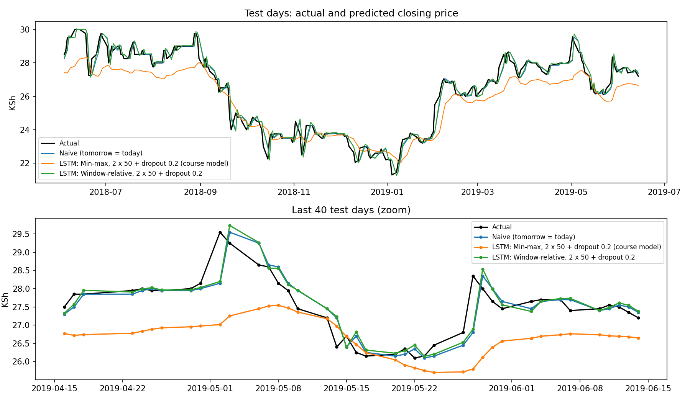

# Safaricom Next-Day Price Forecasting with an LSTM (Apple MLX)

An LSTM built with [Apple MLX](https://github.com/ml-explore/mlx) predicts the next day's closing price of **Safaricom** (NSE: SCOM) from the previous **30 trading days**. It is compared with a naive forecast that repeats today's price.

## Data

- **Source:** Safaricom daily prices on the Nairobi Securities Exchange, 2012-06-11 to 2019-06-14 (1,753 trading days), from the course file `NSE_SCOM_Safaricom.csv` in [ednamilgo/ML-Class](https://github.com/ednamilgo/ML-Class). It downloads automatically.
- **Input:** only the closing price is used. Each sample is a 30-day window and its label is the next day's close.
- **Split:** by time, never shuffled.

| Part | Days | From | To | Price range (KSh) |
|---|---|---|---|---|
| train | 1206 | 2012-07-23 | 2017-05-16 | 3.75 to 21.25 |
| val | 258 | 2017-05-17 | 2018-05-31 | 20.00 to 32.75 |
| test | 259 | 2018-06-04 | 2019-06-14 | 21.30 to 30.00 |

## Results on the test year

| Forecast | MSE | RMSE (KSh) | MAE (KSh) |
|---|---|---|---|
| Naive (tomorrow = today) | 0.1822 | 0.427 | 0.281 |
| LSTM: Min-max, 2 x 50 + dropout 0.2 (course model) | 0.9962 | 0.998 | 0.791 |
| LSTM: Window-relative, 2 x 50 + dropout 0.2 | 0.1781 | 0.422 | 0.286 |

- **The best LSTM matches the naive forecast but does not clearly beat it.** It is slightly better on RMSE and slightly worse on MAE. Daily share prices move very little and close to randomly, so "tomorrow = today" is a very strong baseline.
- **The course-style model fails on new price levels.** It uses min-max scaling fitted on the training years (KSh 3.75 to 21.25), and almost all later prices lie above that range. Scaling each window by its own last price fixes this.



## Tuning (validation year)

| Setting | RMSE (KSh) | MAE (KSh) | MSE |
|---|---|---|---|
| Naive (tomorrow = today) | 0.418 | 0.295 | 0.1744 |
| Min-max, 1 x 50 (course style) | 0.774 | 0.606 | 0.5998 |
| Min-max, 2 x 50 + dropout 0.2 (course model) | 1.147 | 0.889 | 1.3156 |
| Window-relative, 1 x 32 | 0.414 | 0.305 | 0.1713 |
| Window-relative, 1 x 64 | 0.413 | 0.303 | 0.1708 |
| Window-relative, 2 x 50 + dropout 0.2 | 0.413 | 0.302 | 0.1702 |

The best setting was **Window-relative, 2 x 50 + dropout 0.2**.

## Model and training

- **Network:** LSTM layer(s) → the last hidden state → Dense(1), with dropout of 0.2 between the two LSTM layers in the deeper models.
- **Scaling:**
    - **min-max** to 0–1 using the training prices (the course method);
    - **window-relative**, where each window is divided by its last price and the label is the next price divided by today's.
- **Training:** Adam with a learning rate of 0.001, batches of 32 and MSE loss. Early stopping uses the validation loss with a patience of 15, keeping the best weights.

## Run it

Needs an Apple silicon Mac (M1 or later), because MLX runs on Apple's GPU.

```bash
python -m venv .venv
source .venv/bin/activate
pip install -r requirements.txt
```

Open `lstm_safaricom_mlx.ipynb` in VS Code or Jupyter, pick the `.venv` kernel and run all cells. The whole notebook takes about a minute on an M5.

## Files

- `lstm_safaricom_mlx.ipynb`: the notebook, with outputs.
- `figures/`: the price and split, the tuning results, the training curve, the test predictions and the error histogram.
- `results.json`: all the scores.
