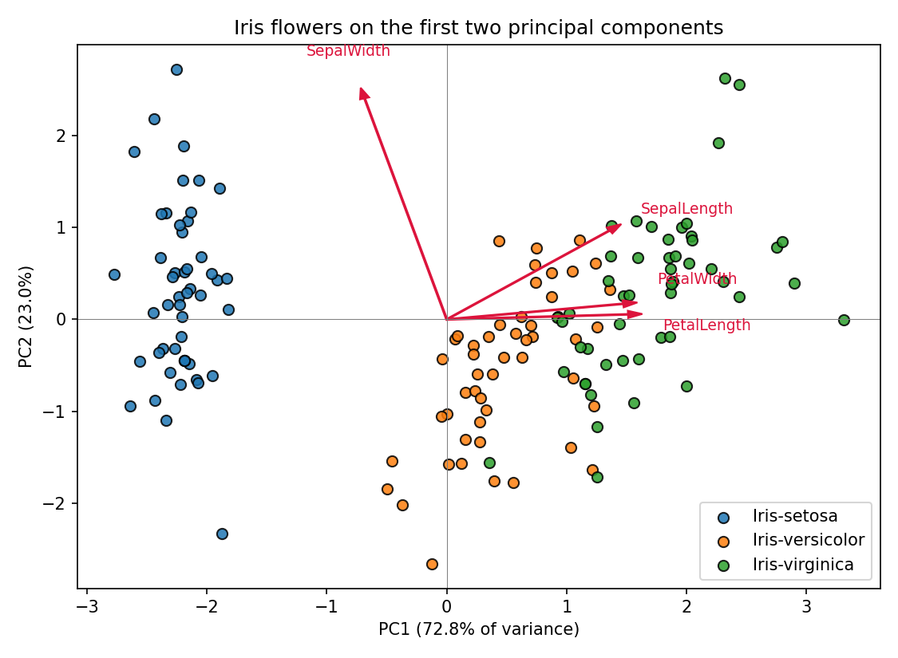

# Dimensionality Reduction of the Iris Dataset with PCA

Principal component analysis (scikit-learn) reduces the four Iris measurements (sepal and petal length and width) to fewer dimensions.

## Results

| Component | Variance explained | Cumulative |
|---|---|---|
| PC1 | 72.8% | 72.8% |
| PC2 | 23.0% | 95.8% |
| PC3 | 3.7% | 99.5% |
| PC4 | 0.5% | 100.0% |

- **Two components keep 95.8% of the variance.**
- **PC1 is overall flower size:** petal length 0.58, petal width 0.57 and sepal length 0.52.
- **PC2 is mostly sepal width** (0.93).
- **Reconstruction:** rebuilding the data from 2 components gives a mean squared error of 0.042 in standardised units.



**Logistic regression accuracy (10-fold CV, scaling and PCA inside the pipeline):**

| Input | Accuracy |
|---|---|
| 4 original features | 95.3% |
| 3 components | 95.3% |
| 2 components | 91.3% |
| 1 component | 92.7% |

## Run it

```bash
python -m venv .venv
source .venv/bin/activate        # Windows: .venv\Scripts\activate
pip install -r requirements.txt
```

Open `pca_iris.ipynb` in VS Code or Jupyter, pick the `.venv` kernel and run all cells. It takes a few seconds.

## Files

- `pca_iris.ipynb`: the notebook, with outputs.
- `figures/`: the scree plot, the 2-D biplot and the accuracy chart.
- `Iris.csv`: the dataset (150 flowers, UCI/Kaggle version).
- `results.json`: the scores.
